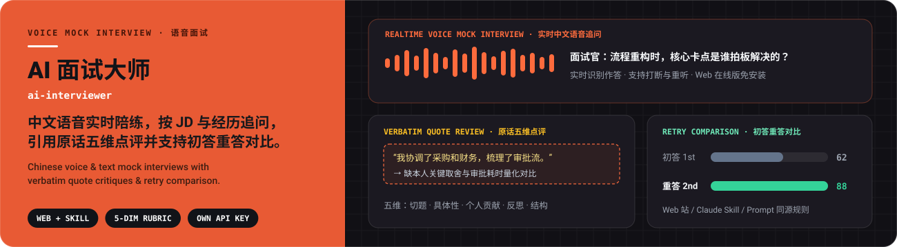
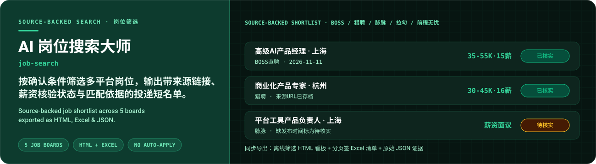
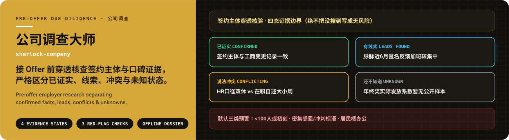
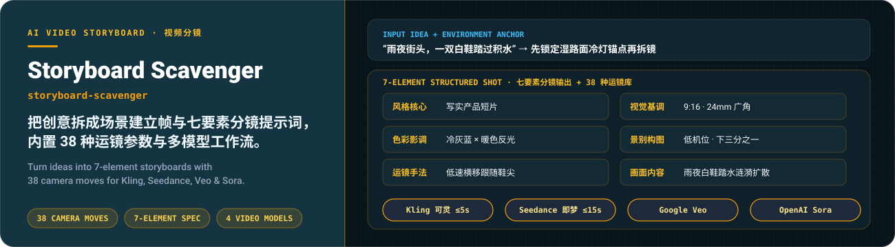
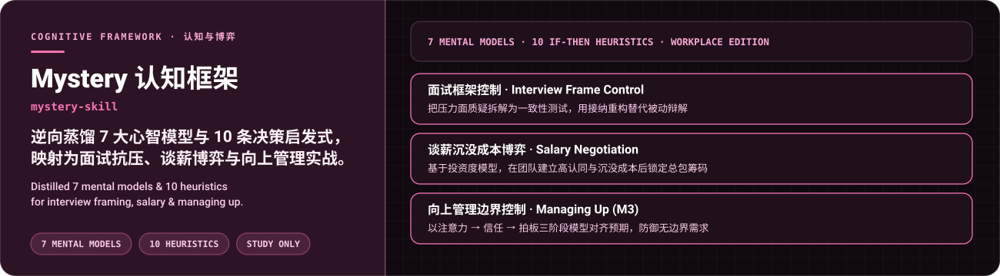
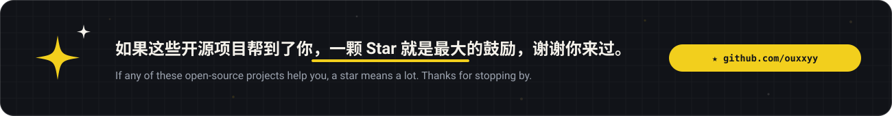

<a href="https://github.com/ouxxyy/ouba-classmate"></a>

<b>9 年网易、搜狐大厂产品经理｜双非普通人，跳槽换行 7 次，涨薪 10 倍｜做过上百次简历与面试优化。致力于把职业价值产品化（职业定位 × AI 杠杆 × 涨薪方法），把真正有效的跳槽涨薪与 AI 创作方法做成免费开源工具。</b><br>
<b>9-year Product Manager at NetEase &amp; Sohu. 7 career moves, 10× salary growth, 100+ resume &amp; interview reviews. Turning proven career positioning, AI leverage, and creative workflows into free open-source tools.</b>

<a href="https://github.com/ouxxyy/ouba-classmate"></a>
<a href="#highlights"></a>
<a href="https://github.com/ouxxyy/ouba-classmate/tree/main/benchmark"></a>
<a href="https://ouxxyy.github.io/ouba-classmate/#career-radar"></a>
<a href="https://interview.redboook.cn/"></a>

> [!TIP]
> 🎁 扫码关注公众号「欧八同学」，免费领取 **AI 案例与 Skill《大厂产品AI经验编程 200 套》** → [去扫码](#author)

<a id="highlights"></a>


## 01 · ouba-classmate · 中文求职与 AI 创作旗舰套件

<a href="https://github.com/ouxxyy/ouba-classmate"></a>

<b>一行命令安装全部 11 个求职与创作 Agent Skills（支持 Claude Code / Cursor / Codex / MCP），内置《12 仓中文 AI 求职 Skill 公开横评》与《2026 求职防身情报库》。</b>零订阅费、简历留在本机，在 [30 秒在线职业战力诊断](https://ouxxyy.github.io/ouba-classmate/#career-radar) 无需安装即可自测。<br>
<b>One-line install for all career &amp; creative Agent Skills across Claude Code, Cursor, Codex, and MCP, bundled with a 12-repo open benchmark and 2026 interview &amp; offer-check handbook.</b> Zero subscription fee; local-first privacy.

<a href="https://ouxxyy.github.io/ouba-classmate/#career-radar"></a>
<a href="https://github.com/ouxxyy/ouba-classmate/tree/main/benchmark"></a>
<a href="https://github.com/ouxxyy/ouba-classmate"></a>


## 02 · jd-resume-match · AI 简历优化大师

<a href="https://github.com/ouxxyy/jd-resume-match"></a>

<b>简历与 JD 逐条对齐并强制绑定原文行号（`L1..Ln`），用 `jd-match-rubric/0.1.0` 确定性公式复算分数，产出现成可用的能力 / 成果 / 简洁三版岗位打招呼语。</b>Python 零依赖 + 279 项单测 + 本地 stdio MCP Server；不做视觉 PDF 排版。<br>
<b>Line-anchored resume vs. JD audit with deterministic rubric scoring, local stdio MCP server, and three tailored outreach greeting drafts.</b> Zero external Python dependencies and 279 unit tests; strictly no fabricated metrics.

<a href="https://ouxxyy.github.io/ouba-classmate/#resume-evidence-checker"></a>
<a href="https://github.com/ouxxyy/jd-resume-match"></a>


## 03 · ai-interviewer · AI 面试大师

<a href="https://github.com/ouxxyy/ai-interviewer"></a>

<b>中文语音 AI 实时模拟面试陪练，围绕真实 JD 与简历经历深挖追问，逐句引用回答原话做五维点评并支持初答重答对比。</b>提供免安装在线 Web 版（使用自己的百炼 Key）、本地服务、Claude Skill 与 Prompt 入口。<br>
<b>Chinese realtime voice &amp; text mock interview coach that probes your JD and resume, critiques with verbatim quotes across 5 dimensions, and compares initial vs. retry answers.</b> Available as Web app, Claude Skill, and standalone prompt.

<a href="https://interview.redboook.cn/"></a>
<a href="https://github.com/ouxxyy/ai-interviewer"></a>


## 04 · job-search · AI 岗位搜索大师

<a href="https://github.com/ouxxyy/job-search"></a>

<b>按你确认的城市、薪资与平台条件检索 BOSS / 猎聘 / 脉脉等招聘网站，生成同一份带来源链接、匹配依据和「待核实」标记的 HTML、Excel 与 JSON 岗位短名单。</b>不自动海投、不代替联系 HR，把筛选决定权留给你自己。<br>
<b>Job search Agent Skill across 5 major boards that compiles source-backed job shortlists into offline HTML dashboards, multi-tab Excel sheets, and JSON evidence logs.</b> Unverified fields stay flagged; never auto-applies.

<a href="https://github.com/ouxxyy/job-search#quick-example"></a>
<a href="https://github.com/ouxxyy/job-search"></a>


## 05 · sherlock-company · 公司调查大师

<a href="https://github.com/ouxxyy/sherlock-company"></a>

<b>接 Offer 前的公司背景证据调查助手：先穿透签约主体，再把公开评价与线索严格落入「已证实 / 有线索 / 说法冲突 / 还不知道」四态，主动排查少于 100 人初创、冲刺标语与居民楼办公三类预警并输出离线 HTML 侦探档案。</b><br>
<b>Pre-offer employer research assistant that verifies the actual contracting entity, separates claims into Confirmed / Leads / Conflicting / Unknown, flags three default warning checks, and exports an offline HTML dossier.</b>

<a href="https://github.com/ouxxyy/sherlock-company/tree/main/cases/4399"></a>
<a href="https://github.com/ouxxyy/sherlock-company"></a>


## 06 · codex-gif-video · GPT Image 2.6 原生 GIF 短视频

<a href="https://github.com/ouxxyy/codex-gif-video"></a>

<b>通过 OpenAI GPT API 调用 GPT Image 2.6 原生 GIF 能力，按 69 种内置画风并锁定跨镜头同一人物，直接输出无字幕、无水印的长 GIF 或静音 MP4，适合 X 短视频、口播 B-roll、绘本及搭配 Hypit / Remotion 成片。</b><br>
<b>Generate clean, text-free multi-shot GIFs and silent MP4 clips via OpenAI GPT Image 2.6 across 69 built-in styles with character consistency — ideal for X posts, voiceover B-roll, and Hypit / Remotion pipelines.</b>

<a href="https://github.com/ouxxyy/codex-gif-video#demo"></a>
<a href="https://github.com/ouxxyy/codex-gif-video"></a>


## 07 · storyboard-scavenger · AI 视频七要素分镜

<a href="https://github.com/ouxxyy/storyboard-scavenger"></a>

<b>把一句创意、参考图或音乐拆解成场景建立帧与「风格 / 基调 / 影调 / 景别 / 构图 / 运镜 / 画面」七要素分镜，自带 38 种运镜技巧参数库及可灵 Kling、即梦 Seedance、Veo、Sora 专属工作流。</b><br>
<b>Structured AI video storyboarding skill converting rough ideas into environment anchors, 7-element shot specs, and 38 camera movements tailored for Kling, Seedance, Veo, and Sora.</b>

<a href="https://github.com/ouxxyy/storyboard-scavenger/blob/main/templates/storyboard-template.md"></a>
<a href="https://github.com/ouxxyy/storyboard-scavenger"></a>


## 08 · mystery-skill · 认知蒸馏框架与职场心理博弈

<a href="https://github.com/ouxxyy/mystery-skill"></a>

<b>从公开著作与访谈中逆向提炼 7 个核心心智模型与 10 条 If-Then 决策启发式，并映射为面试压力面框架控制、谈薪底牌博弈、向上管理边界防御三套职场实战专版（仅供个人学习研究）。</b><br>
<b>Reverse-engineered cognitive framework distilling 7 mental models and 10 If-Then heuristics into practical playbooks for interview frame control, salary negotiation, and managing up (non-commercial study).</b>

<a href="https://github.com/ouxxyy/mystery-skill/tree/main/workplace"></a>
<a href="https://github.com/ouxxyy/mystery-skill"></a>


## 更多原创项目 · More Original Tools

| 项目 · Repo | 中文说明 | English Summary | Star |
| --- | --- | --- | --- |
| **[mbai](https://github.com/ouxxyy/mbai)** | **AI 转型大师**：任务级拆解工作自动化空间、个人贡献与 7 天求职作品证据（CC BY-NC 4.0） | Task-level AI resilience assessment turning daily work into provable interview artifacts |  |
| **[travel-art-album-skill](https://github.com/ouxxyy/travel-art-album-skill)** | **重拍画册**：10–30 张照片先出 4 种风格小样确认，打包单文件离线 HTML 翻页相册 | Preview 4 art styles on travel photos, then bundle into a single-file offline flipbook |  |
| **[Attention](https://github.com/ouxxyy/Attention)** | **本地专注力仪表盘**：读取 ActivityWatch 桌面数据，分析任务切换、分心扣分与 25m+ 心流时段 | Local-first ActivityWatch dashboard tracking distraction scores, switches &amp; deep flow |  |
| **[postapp](https://github.com/ouxxyy/postapp)** | **姿势企鹅**：本地 MoveNet 姿态检测的 Chrome 坐姿提醒插件，图像不离开浏览器 | On-device MoveNet Chrome MV3 posture reminder with zero cloud upload |  |

> **🚀 准备跳槽涨薪？建议按这四步串联使用**：① [**job-search**](https://github.com/ouxxyy/job-search) 整理来源清晰的岗位短名单 → ② [**jd-resume-match**](https://github.com/ouxxyy/jd-resume-match) 对照 JD 找简历证据缺口与算分 → ③ [**ai-interviewer**](https://github.com/ouxxyy/ai-interviewer) 语音练经历面试并对比重答 → ④ [**sherlock-company**](https://github.com/ouxxyy/sherlock-company) 接 Offer 前穿透查公司并列核实清单。完整目录与机器可读清单见 **[ouxxyy/ouba-classmate](https://github.com/ouxxyy/ouba-classmate)**（[llms.txt](llms.txt)）。

```bash
# 一行安装全部中文求职与 AI 创作 Skills（Claude Code / Cursor / Codex / MCP）
claude plugin marketplace add ouxxyy/ouba-classmate
npx skills add ouxxyy/ouba-classmate

# 觉得有用？在终端 1 秒为开源主仓点亮一颗 Star
gh api -X PUT /user/starred/ouxxyy/ouba-classmate
```

<a id="author"></a>

## 作者 · Author

全平台同名：**欧八同学** · **9 年网易、搜狐大厂产品经理｜跳槽换行 7 次，涨薪 10 倍｜做过上百次简历与面试优化。**

- 个人主页 / 联系我：[albertou.redboook.cn](https://albertou.redboook.cn/)
- 微信公众号：扫码关注，免费领取 AI 案例与 Skill《大厂产品AI经验编程 200 套》
- 抖音：[搜索“欧八同学”](https://www.douyin.com/search/%E6%AC%A7%E5%85%AB%E5%90%8C%E5%AD%A6) · 小红书：[搜索“欧八同学”](https://www.xiaohongshu.com/search_result?keyword=%E6%AC%A7%E5%85%AB%E5%90%8C%E5%AD%A6) · X：[搜索“欧八同学”](https://x.com/search?q=%E6%AC%A7%E5%85%AB%E5%90%8C%E5%AD%A6&amp;src=typed_query)

<p align="center">
  
</p>

<p align="center"><sub>扫码关注「欧八同学」，免费领取《大厂产品AI经验编程 200 套》</sub></p>

<a href="https://github.com/ouxxyy/ouba-classmate"></a>
